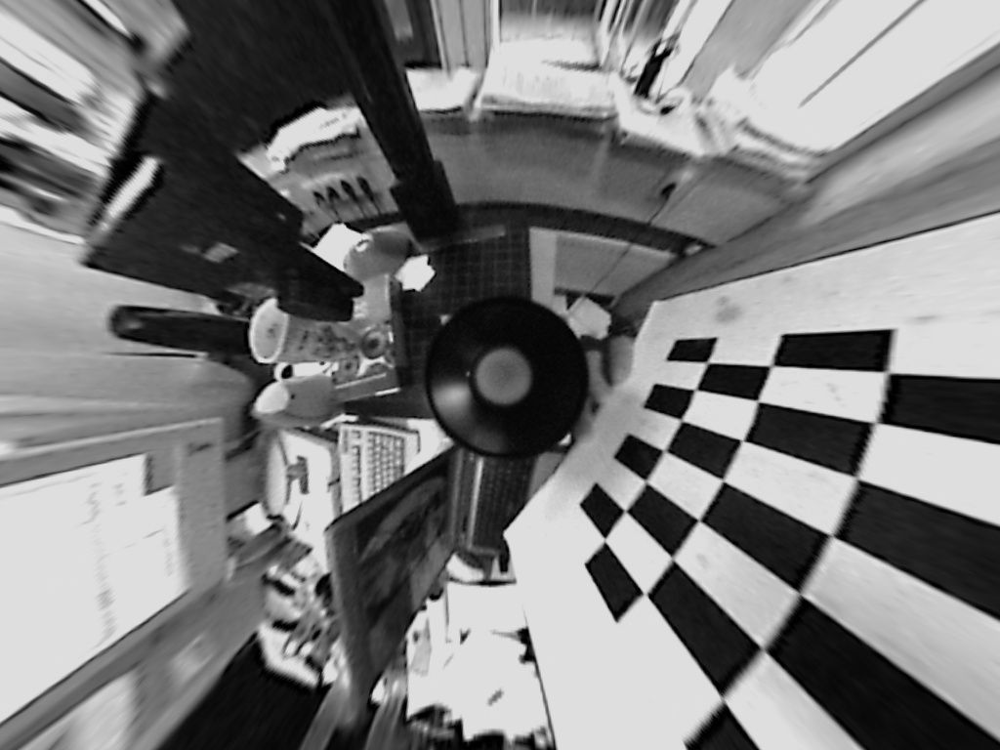
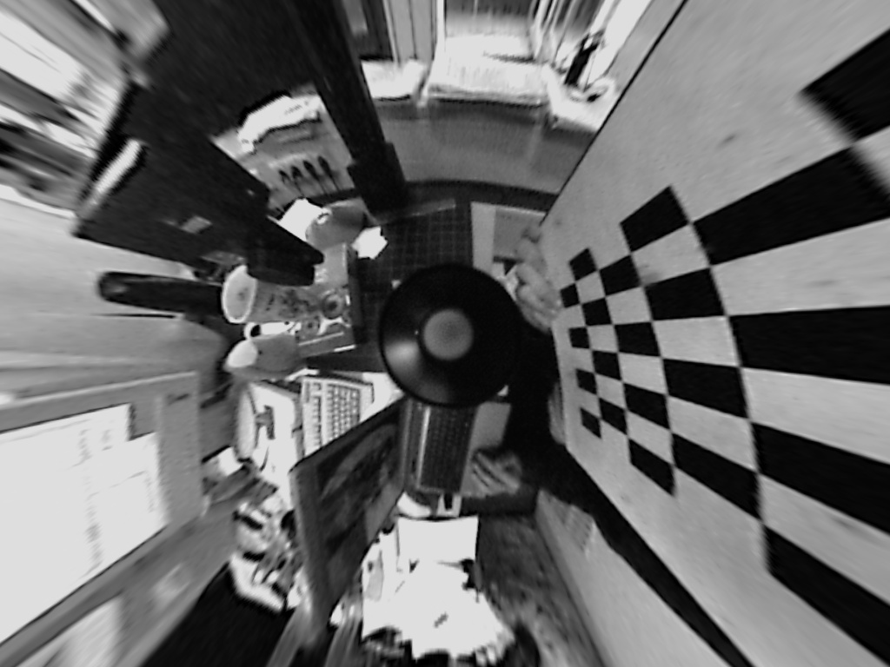

# LensCalib

**Stereo and fisheye camera calibration with OpenCV: intrinsics, extrinsics and lens distortion correction.**


LensCalib estimates the geometric model of real cameras from chessboard images. It calibrates both cameras of a **stereo pair** (pinhole model) and a **fisheye** camera (Kannala–Brandt model), then uses the fisheye model to remove lens distortion from the images.

> Lab project for the *Computer Vision I* course, Universidad Pontificia Comillas (ICAI).

---

## What it does

**Part A: Stereo pair calibration (pinhole model)**
1. Detect chessboard inner corners (8 × 6) with `cv2.findChessboardCorners()`.
2. Refine them to **sub-pixel** accuracy with `cv2.cornerSubPix()`.
3. Build the 3D object points of the pattern (30 mm squares) in a frame attached to the board.
4. Estimate the intrinsic matrix, distortion coefficients and per-image extrinsics `[R | t]` with `cv2.calibrateCamera()` (rotations via Rodrigues).

**Part B: Fisheye calibration and undistortion**
1. Detect and refine 7 × 6 corners on fisheye images.
2. Calibrate with `cv2.fisheye.calibrate()` (fixed skew, recomputed extrinsics).
3. Build undistortion maps with `cv2.fisheye.initUndistortRectifyMap()` and correct the images with `cv2.remap()`.

## Results

| Camera | Valid detections | RMS reprojection error | fx, fy (px) |
|---|---|---|---|
| Left | 19 / 19 | **0.185 px** | 424.5, 426.7 |
| Right | 17 / 19 | **0.103 px** | 429.7, 430.9 |
| Fisheye | 10 / 10 | — | — |

**Does sub-pixel refinement matter?** The notebook includes an experiment that calibrates with and without `cornerSubPix()`:

| Camera | Mean corner shift | Max shift | RMS unrefined | RMS refined |
|---|---|---|---|---|
| Left | 0.14 px | 2.98 px | 0.1846 px | 0.1848 px |
| Right | 0.10 px | 1.14 px | 0.1457 px | **0.1028 px (−30 %)** |

Refinement barely moves the corners, because OpenCV 4.x already refines internally. Even so, it cuts the right camera's reprojection error by 30 %, so it is worth always applying.

**Fisheye undistortion.** The chessboard lines in the corrected image are straight again:

<p align="center">
  
  
</p>

## Getting started

```bash
git clone https://github.com/javmartineez/LensCalib.git
cd LensCalib
pip install opencv-python numpy imageio matplotlib jupyter
```

The calibration images are not included. Place them in `data/left/`, `data/right/` and `data/fisheye/`, then open the notebook:

```bash
cd src
jupyter notebook lab_2.ipynb
```

## Project structure

```
LensCalib/
├── src/lab_2.ipynb     # Calibration and undistortion notebook
└── results/            # Undistorted fisheye images
```

## Tech stack

Python · OpenCV · NumPy · Matplotlib · Jupyter

## Authors

- **Javier Martínez Berenguer** · [GitHub](https://github.com/javmartineez)
- **Javier Mochales López** · [GitHub](https://github.com/jmochales06)
